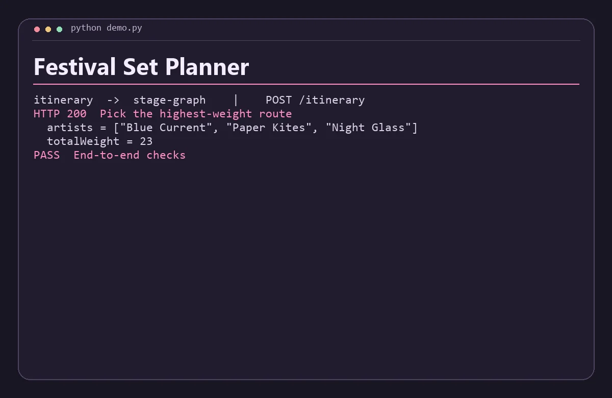

# Festival Set Planner

Build a festival itinerary around favorite sets while accounting for walking time between stages.



## Run the demo

Install Python 3.11+, Node.js 22+, .NET 8 SDK and runtime, then run this from the repository root.

```sh
python demo.py
```

The command starts both services on separate loopback ports, sends the requests in `examples.json`, checks the responses, and shuts down the processes. Use `python3` if that is how your system exposes Python.

## Run the services with Docker Compose

```sh
docker compose up -d --build
python demo.py --base-url http://127.0.0.1:8080
docker compose down
```

The API binds to loopback on port 8080 by default. Set `DEMO_PORT` and use the matching base URL to run another project alongside it. Set-up and service discovery follow the [Docker Compose networking documentation](https://docs.docker.com/compose/how-tos/networking/).

Both services are stateless and work with the data in each request. Start from fresh demo state before rerunning the scripted Compose checks.

## Architecture

Stage Graph finds the maximum-weight compatible sequence using dynamic programming. Itinerary supplies the schedule and turns the resulting IDs into a readable lineup. Compatibility includes the given stage-to-stage walk time.

| Service | Runtime | Operation |
| --- | --- | --- |
| `itinerary` | JavaScript | Public demo API, `POST /itinerary` |
| `stage-graph` | C# | Internal service, `POST /optimize` |

The two services exchange JSON over HTTP. Each has a `GET /health` endpoint for process readiness. A gateway request returns HTTP 502 when its dependency is unavailable or fails unexpectedly. Invalid input returns HTTP 400. Domain conflicts return HTTP 409 where supported.

## API example

Send sets with id, artist, stage, start, end and weight. Times are minutes from midnight and weights are nonnegative. Walk minutes apply between stages; sets on the same stage need no walk time. Up to 200 sets are supported.

From a running Compose stack, save this JSON as `input.json` and run the command below. On Windows use `curl.exe` if your shell aliases `curl`.

```json
{
  "walk": 10,
  "sets": [
    {
      "id": "a",
      "artist": "Blue Current",
      "stage": "Pier",
      "start": 600,
      "end": 650,
      "weight": 8
    },
    {
      "id": "b",
      "artist": "Low Tide",
      "stage": "Dune",
      "start": 655,
      "end": 690,
      "weight": 9
    },
    {
      "id": "c",
      "artist": "Paper Kites",
      "stage": "Pier",
      "start": 650,
      "end": 680,
      "weight": 5
    },
    {
      "id": "d",
      "artist": "Night Glass",
      "stage": "Dune",
      "start": 700,
      "end": 750,
      "weight": 10
    }
  ]
}
```

```sh
curl -s -H "Content-Type: application/json" --data-binary @input.json http://127.0.0.1:8080/itinerary
```

The response includes these fields.

```json
{
  "artists": [
    "Blue Current",
    "Paper Kites",
    "Night Glass"
  ],
  "totalWeight": 23
}
```

## Scope

This is a local portfolio project using synthetic data. The APIs are intended for loopback and the private Compose network. A public deployment would need authentication, rate limits, and production observability.
